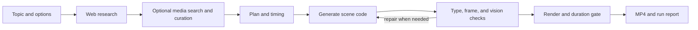

# Video Generation Agent

Turn a topic into a 20–60 second animated explainer. The Python agent researches
the topic, plans scenes, writes Remotion code, checks the frames, and renders an
MP4. Videos default to vertical 9:16; choose 16:9 for landscape. Music,
web-fetched media, and voice-over are optional.

## Get started

You need Python 3.11+, Node.js with npm, and `ffmpeg`/`ffprobe`. On Ubuntu,
install FFmpeg with `sudo apt-get install ffmpeg`; on macOS, use
`brew install ffmpeg`. No third-party Python packages are needed to run the
agent; its automated tests use the `test` extra.

```bash
# Clone this repository, then enter it.
python3 -m venv .venv
source .venv/bin/activate
python -m pip install -e '.[test]'
npm ci
cp .env.example .env
```

Add an `OPENROUTER_API_KEY` to `.env`, then check the machine:

```bash
python -m vga doctor
```

Generate a video:

```bash
python -m vga run \
  --idea "How a voice note travels between phones" \
  --target 30 \
  --pack forest-ink \
  --fetch-media \
  --music
```

The result is saved under `data/projects/<id>/render/final.mp4`. The command
prints the generated project ID and whether its checks passed. A run can render
an MP4 and still fail QA; inspect `run.json` before publishing.

## What happens during a run



1. **Research:** when `TAVILY_API_KEY` is set, the agent searches for topic-
   specific visual references. It records their URLs and short excerpts in
   `run.json`; it does not embed external websites or run their JavaScript.
2. **Media (optional):** `--fetch-media` searches for images and animated GIFs.
   If `PEXELS_API_KEY` is set, it can also search for stock clips. The agent
   validates downloaded files, checks GIF/WebP animation, and uses a vision
   pass to remove irrelevant or watermarked results and describe the rest.
   Only selected media is retained in the project and staged locally for the
   renderer. If no suitable media is found, scenes can be drawn from scratch.
3. **Plan and timing:** the model creates a title, angle, scene sequence,
   compositions, and visible start/action/end beats. Deterministic code assigns
   frame counts so the scenes match the requested length.
4. **Scene code and checks:** the model writes scene components using the
   repository's Remotion primitives and style packs. Import and safety rules,
   TypeScript, rendered-frame checks, and vision review catch broken layouts,
   blank frames, unsafe edges, weak motion, repetition, and media mismatch.
   Rejected drafts are sent back with the specific issues for repair.
5. **Render and gate:** Remotion renders the storyboard, then `ffprobe` checks
   the result. The video must be 20–60 seconds and within two seconds of the
   requested duration. `run.json` records stage progress, usage, and QA—even
   when a run fails.

The default model is Claude Sonnet 5.5 through OpenRouter. Scene code is
frame-driven so it renders reproducibly. The review gate improves reliability,
but every finished video still needs editorial and factual review before
publication.

## Cost estimate

The current default model price is **$2 per million input tokens and $10 per
million output tokens**. The table is a planning estimate for model usage,
based on this repo's 20–25 second runs and the default repair budget; retries,
scene count, visual-review images, and model settings can move the result
substantially.

| Target length | Estimated model cost per video |
|---:|---:|
| 30 seconds | $0.70–$1.30 |
| 45 seconds | $0.90–$1.80 |
| 60 seconds | $1.20–$2.40 |

These are estimates, not a quote. Check `usage.estimated_usd` in the project's
`run.json` for the agent's token-based estimate after each run. It does not
include Tavily/Pexels usage, optional ElevenLabs voice-over, applicable taxes,
or OpenRouter's fee when buying credits. Generated music and rendering run
locally. OpenRouter can change model rates; see the
[current model price](https://openrouter.ai/anthropic/claude-sonnet-5.5) and
[billing details](https://openrouter.ai/pricing) before budgeting.

## Common commands

```bash
# Fast, fully drawn animation without online research or media
python -m vga run --idea "How noise cancelling headphones work" --target 30 --no-web-research

# Landscape output with a chosen style pack
python -m vga run --idea "How a heat pump moves energy" --target 45 --aspect 16:9 --pack clinical-slate

# Use online images/GIFs and generated background music
python -m vga run --idea "How a lawn grows from seed" --target 30 --fetch-media --music

# Add narration (requires ELEVENLABS_API_KEY)
python -m vga run --idea "How an electric motor spins" --target 30 --voice --music

# Inspect, list, render again, or export review stills
python -m vga inspect <project-id>
python -m vga list
python -m vga render <project-id>
python -m vga stills <project-id> --frames 30,120,300
```

`--music` uses a local track from `data/music/` when available, otherwise it
creates a deterministic instrumental cue. `--music path/to/track.mp3` selects a
specific licensed track. `--voice` requires ElevenLabs credentials. Use
`--no-review` only when you deliberately want to skip the final vision check;
the resulting video is not fully quality-verified.

## Provide your own media

You can pass an `assets.json` file or a directory containing it. File paths are
relative to that manifest. Use `kind: "image"` for a still or GIF/WebP,
`kind: "clip"` for video, or `kind: "tweet"` / `"news"` for text that should
be reconstructed as a themed card.

```json
[
  {
    "id": "seed-photo",
    "kind": "image",
    "file": "seed.jpg",
    "caption": "Germinating bean seed",
    "source": "My garden, 2026"
  }
]
```

```bash
python -m vga run --idea "How a bean grows" --target 30 --assets ./my-media
```

Web search does not grant reuse rights. Commons assets preserve their file-page
source and license metadata; verify each asset's terms before publication.
Attribution and license details can vary for other search sources.

## Configuration

Copy `.env.example` and set the keys needed for your workflow. Do not commit
`.env` or API keys.

| Variable | Purpose |
|---|---|
| `OPENROUTER_API_KEY` | Required for planning, scene generation, and vision review |
| `TAVILY_API_KEY` | Optional web research and image search |
| `PEXELS_API_KEY` | Optional stock-video search |
| `ELEVENLABS_API_KEY` | Optional `--voice` narration |
| `VGA_MODEL` | Override the default model |
| `VGA_PLAN_MODEL`, `VGA_CODEGEN_MODEL`, `VGA_REVIEW_MODEL` | Choose a model per stage |
| `VGA_CODEGEN_ATTEMPTS` | Scene repair limit, 1–6 (default 4) |
| `VGA_MUSIC_DIR` | Local music library (default `data/music/`) |
| `VGA_PACK` | Default style pack; a CLI `--pack` takes precedence |

Run `python -m vga doctor` to see which features are configured. Web research
and media search are optional; caller-provided assets do not require Tavily.

## Project files and development

Generated projects are local runtime data and are ignored by Git. A project
contains:

- `run.json`: plan, events, model usage, checks, and final QA status.
- `storyboard.json`: timed scene and frame data used by the renderer.
- `assets.json` and `assets/`: the selected media and retained source files,
  when media is used.
- `code/scenes.tsx`: final generated scene code.
- `render/final.mp4`: rendered video; kept for inspection even if QA fails.
- `qa/`: review frames retained when a run needs diagnosis.

This is one tool with two runtimes, not two competing implementations:

- **Python (`vga/`) is the agent and command-line entry point.** It owns
  research, media search, planning, model calls, validation, retries, audio,
  and run records. Start it with `python -m vga` or the installed `vga`
  command.
- **TypeScript/Node is the video renderer.** `src/components/foundation/` and
  `src/packs/` provide Remotion visuals and themes. Python writes each video's
  scene components under `src/generated/<id>/`; `renderer/render.mjs` invokes
  Remotion to render those scenes into the MP4. Node does not run the agent.

Generated per-project code lives in `src/generated/` during use and should
not be committed.

Run the checks before submitting a code change:

```bash
npm run test:py
npm run typecheck
```

## Troubleshooting

- **Doctor reports no LLM:** add `OPENROUTER_API_KEY` to `.env` and rerun it.
- **Render tools missing:** install Node.js/npm and `ffmpeg`/`ffprobe`, then run
  `npm ci` and `python -m vga doctor` again.
- **No fetched media:** verify `TAVILY_API_KEY`; search is best-effort and the
  agent continues with original animation when no usable files are found.
- **QA failed:** read `qa` and `events` in `data/projects/<id>/run.json`.
  The MP4 may exist for inspection, but a failed report means the video did not
  pass the configured checks.
